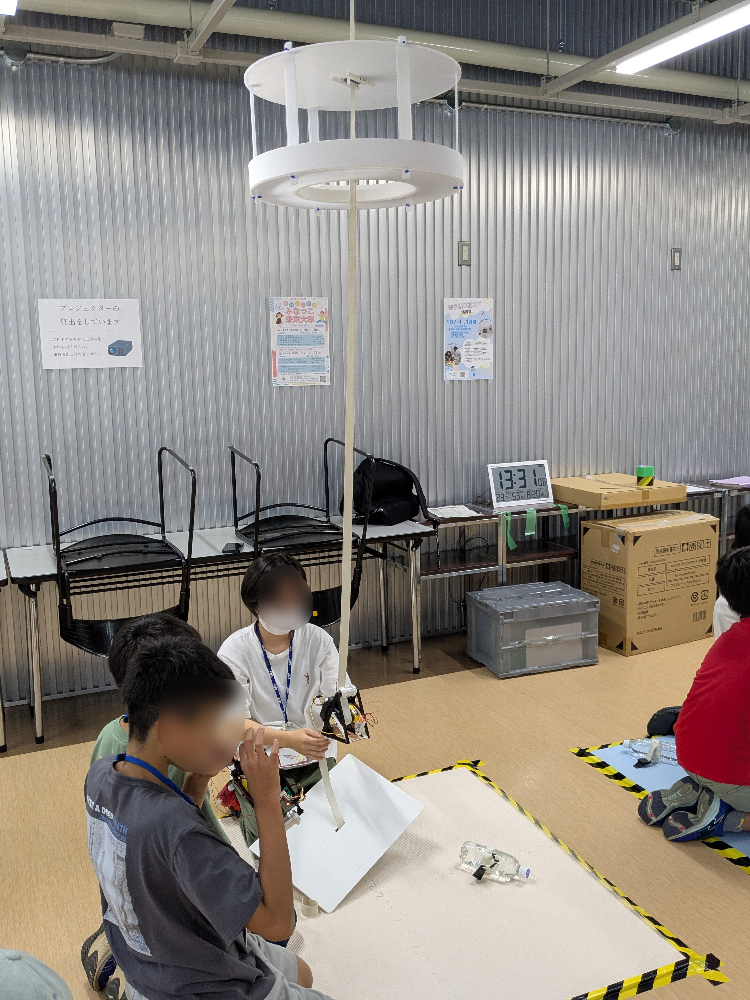

2025年8月19日（火）・20日（水）にふなっこ未来大学を未来博士工房が協力し船橋キャンパスで開催しました．
ふなっこ未来大学は船橋市教育委員会青少年課が主催する，子どもたちがわくわくするような体験を提供し，「子どもたちが主体的に考え，学びに向かう力を育み，将来の夢や目標をもち，自己肯定感を高めるきっかけとする」ことを目的とした，小学生が対象のイベントです．本研究室では初めて参加し，未来博士工房の学生と企画した宇宙エレベーターの講座では船橋市内在住の小学校4〜6年生の約20名が参加しました．

講座名：未来を開く夢の乗り物「宇宙エレベーター」

学生が主体となって企画した講座で，参加者の小学生の皆さんは目を輝かせ，楽しそうに受講していました．

